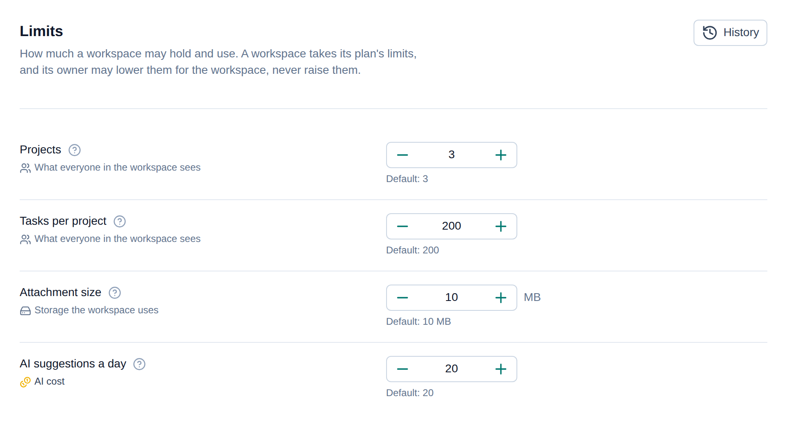
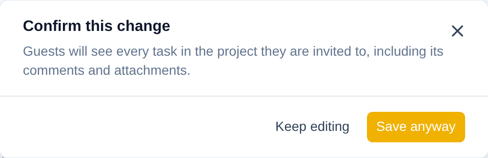
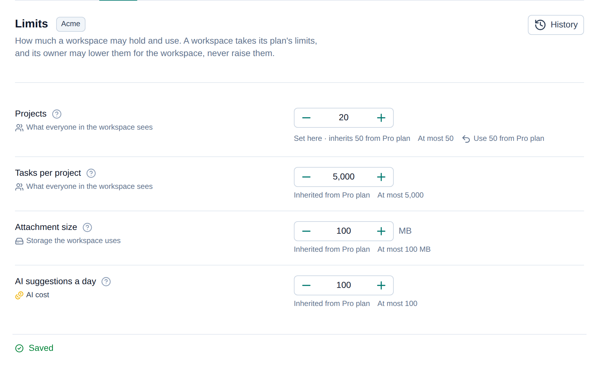
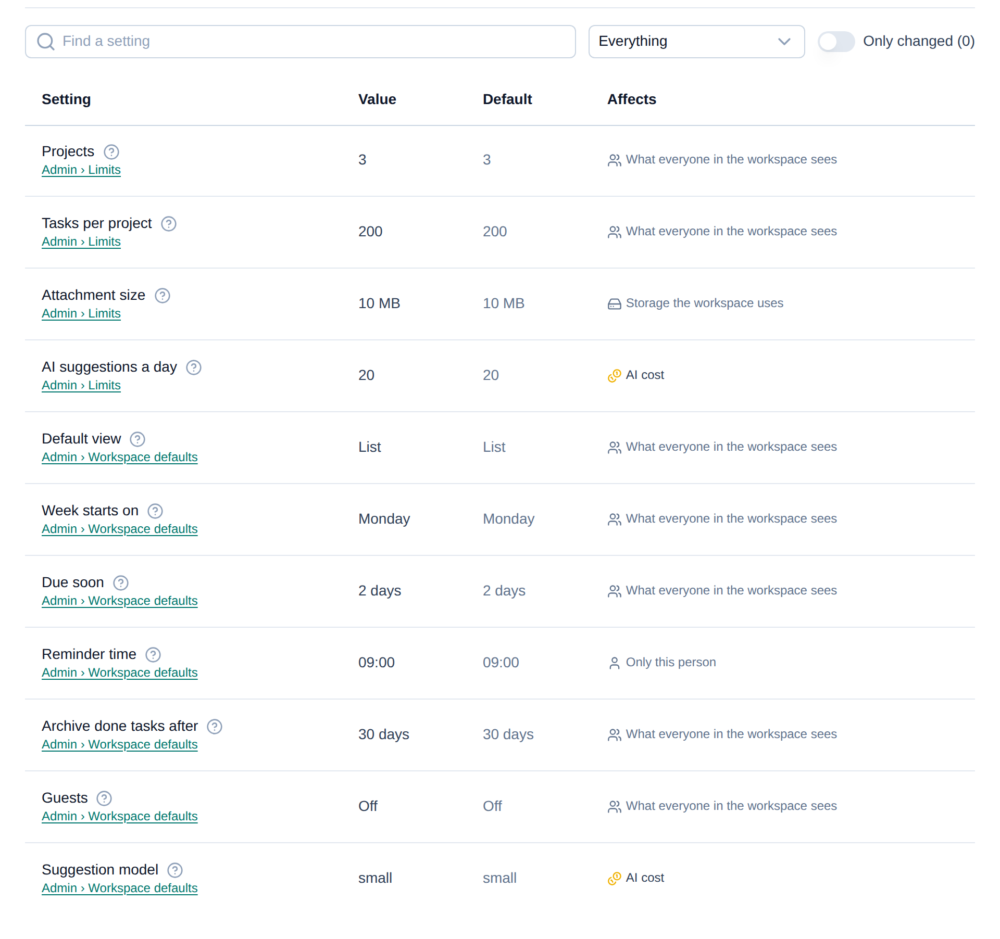
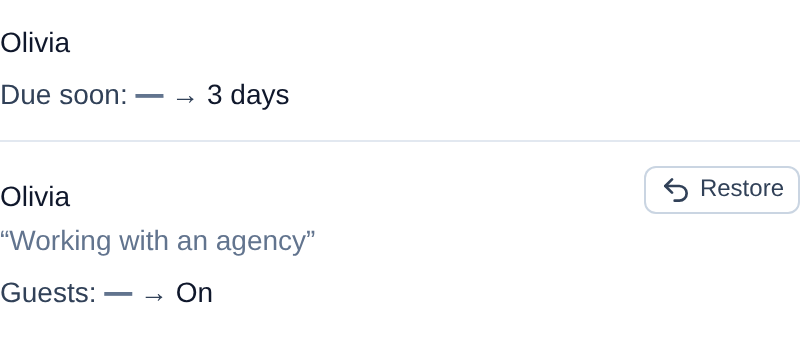
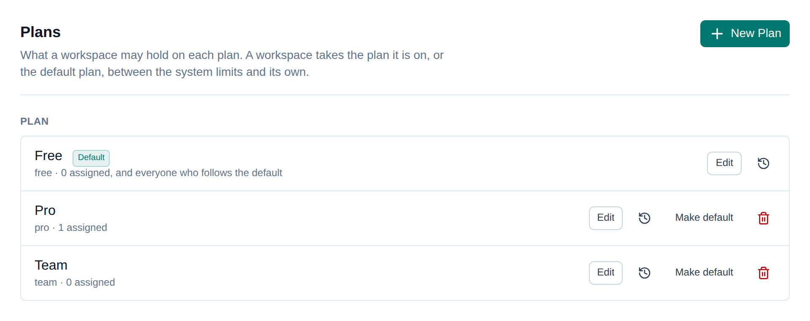
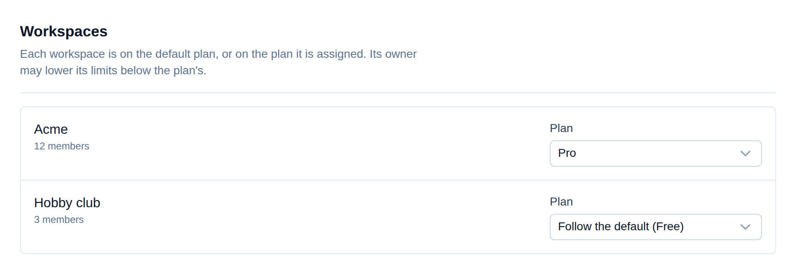
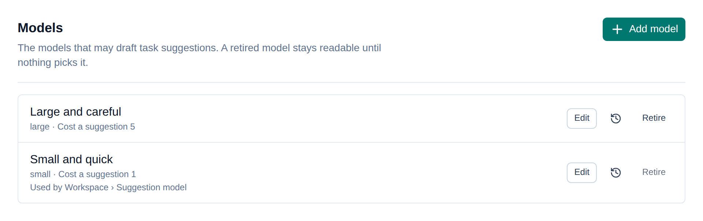
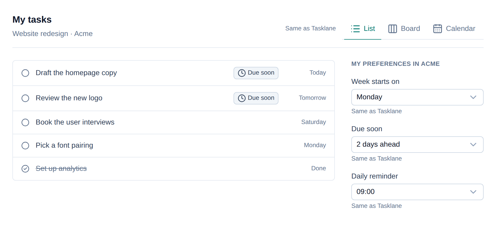

# The Nuxt layer

`tunables/nuxt` is a Nuxt layer with the screens an administrator needs, built
on Nuxt UI. Extend it, and its components are available on every page of your
app, in your app's own theme.

They are made for the pages where someone administers values: your staff's
administration, and a customer's own settings page, such as a workspace's.
Inside your product, where a person picks a view or a week while they work,
build the control your product needs on the [Vue composables](./vue-composables.md)
instead; see [Your own screens](#your-own-screens).

The pictures on this page are the components as they render in
[Tasklane](./tasklane-example.md#the-playground), in Nuxt UI's default theme.

```ts [nuxt.config.ts]
export default defineNuxtConfig({
  extends: ['tunables/nuxt'],
  modules: ['@nuxt/ui']
})
```

It needs `nuxt` 4.4 or later and `@nuxt/ui` 4.9 or later in your app, and the
API mounted in your server: see [Server and access](./server.md). Tailwind has
to see the layer's components to generate their classes; see
[Theming](./theming.md#let-tailwind-see-the-components).

## Where the screens go

Put each group's form on the page beside what it affects, not on one settings
page: limits on the admin's Limits page, a workspace's own settings on that
workspace's settings page. A group's `place` names the page that edits its
system value, because All settings shows system values and links each group
there. The screens never decide who may see them: guard each page
with your own route middleware, and the API with `authorize`.

## The components

| Component | Props | Shows |
| --- | --- | --- |
| `TunablesGroupForm` | `group`, `scope?`, `history?`, `bare?`, `footer?`, `size?` | One group's form, for the system or one scope |
| `TunablesOverview` | none | All settings, read-only |
| `TunablesHistory` | `target` | A target's revisions, with restore for groups |
| `TunablesPresets` | `set`, `bare?`, `size?` | A preset set, by slot |
| `TunablesAssign` | `set`, `subject`, `for-slot`, `label?` | The preset one subject follows for one slot |
| `TunablesCatalog` | `catalog`, `bare?`, `size?` | A catalog's entries |
| `TunablesFieldHint` | `label`, `help?`, `defaultDisplay?` | The question mark beside a label, for your own forms |

`bare` leaves the title and description to the page around a screen, for an app
whose own page header already says them. `footer` names an element, such as
`#page-footer`, that the group form's unsaved-changes bar is placed in instead
of sticking to the form's bottom. `size` sets the size of every control, such as
`md` in an administration whose forms read larger than the rest of the app. Each
field has an address, `#tunables-<key>`, and each section of a group
`#tunables-<group>-<section>`, so a search or a link can open the page at it.

### TunablesGroupForm

```vue [app/pages/admin/limits.vue]
<template>
  <TunablesGroupForm group="limits" />
</template>
```



One group, edited as a whole:

- every field under its section, with a section menu when there are several;
- each field's label, its explanation and default behind a question mark, what
  changing it affects, and the group's [notes](./checks-and-guards.md#notes);
- the input its [kind](./kinds-and-units.md) calls for, a mark on each unsaved
  change, and a way back to the default;
- one bar for the unsaved changes, with a reason that is kept in the history,
  Discard and Save;
- each problem beside the field it is about, and the rest above the form;
- a dialog for a change that asks to be [confirmed](./checks-and-guards.md#confirmations-for-costly-changes);

  

- the group's history in a side panel, with restore. Pass `:history="false"`
  to leave it out.

Leaving the page with unsaved changes asks first, by link or by closing the
tab.

Given a `scope`, the form edits that [scope](./scopes.md)'s own values:

```vue [app/pages/workspace.vue]
<template>
  <TunablesGroupForm group="limits" :scope="{ workspace: 'acme' }" />
</template>
```



- a badge beside the title names the scope, as your `scopeLabel` reads it;
- only the fields that scope may set are shown, or a line saying it may set
  none;
- each field says where its value comes from, *Inherited from Pro plan* or
  *Set here · inherits 50 from Pro plan*, with its bound, *At most 50*;
- a field set here offers *Use 50 from Pro plan* in place of the way back to
  its default;
- the history panel lists that scope's own revisions.

Your `authorize` must let the person reach their scope, and read the
description; see [Who can do what](./access.md#self-service-per-scope).

### TunablesOverview

```vue [app/pages/admin/settings.vue]
<template>
  <TunablesOverview />
</template>
```



All settings on one page: every field of every group, its value beside its
default, what it affects, and a link to where it is edited. Find a setting by
name, filter by what it affects, or show only what differs from the defaults.
It is read-only; changes happen on each group's own form.

### TunablesHistory

```vue
<TunablesHistory :target="{ kind: 'preset', name: 'plans', id: 'pro' }" />
```



Revisions newest first, a page at a time: who, when, why, and each value
before and after, as it reads. A group's revisions can be restored, through
the same checks as a save. It emits `restored`.

### TunablesPresets and TunablesAssign

```vue [app/pages/admin/plans.vue]
<template>
  <TunablesPresets set="plans" />
</template>
```



A preset set by slot: each preset, which is the default, how many subjects are
assigned it, and its history; create, edit, make default and remove.

A preset is a named whole, so its editor shows no per-field default and no
reset. A new preset starts as a copy of its slot's default, and starts again
from the other slot's default if the slot is changed before anything else. A
field held below a setting with `atMost` shows that setting's current value
beside it.

Say what each row should tell about a preset's values with the `summary` slot:

```vue
<TunablesPresets set="plans">
  <template #summary="{ preset }">
    <p class="text-sm">{{ preset.values.maxProjects }} projects</p>
  </template>
</TunablesPresets>
```

`TunablesAssign` goes where your app shows a subject, such as a workspace's
row in the admin's list of workspaces:

```vue
<TunablesAssign set="plans" :subject="workspace.id" for-slot="plan" label="Plan" />
```



It offers *Follow the default* and every preset in the slot, and emits
`changed` with the key chosen, or `null` for the default. Each assignment is a
revision of that subject; show them with
`<TunablesHistory :target="{ kind: 'assignment', name: 'plans', id: workspace.id }" />`.

### TunablesCatalog

```vue [app/pages/admin/models.vue]
<template>
  <TunablesCatalog catalog="models" />
</template>
```



Every entry with its state, its values and what uses it; add, edit, retire and
reinstate. An entry in use cannot be retired, and the screen says by what. The
`summary` slot, given `{ entry }`, replaces the line of values with your own.

## Another client

The screens call the API through a client. By default the layer provides
`fetchClient` at `appConfig.tunables.baseURL`, which is `/api/tunables`:

```ts [app/app.config.ts]
export default defineAppConfig({
  tunables: { baseURL: '/admin/api/tunables' }
})
```

To call tunables through your oRPC router instead, set `baseURL: false` and
provide the client from a plugin of your own:

```ts [app/app.config.ts]
export default defineAppConfig({
  tunables: { baseURL: false }
})
```

```ts [app/plugins/tunables.ts]
import { createORPCClient } from '@orpc/client'
import { RPCLink } from '@orpc/client/fetch'
import { orpcClient } from 'tunables/client'
import { TUNABLES_CLIENT } from 'tunables/vue'

export default defineNuxtPlugin((nuxtApp) => {
  const origin = import.meta.server ? useRequestURL().origin : window.location.origin
  const link = new RPCLink({ url: `${origin}/rpc`, headers: () => import.meta.server ? useRequestHeaders(['cookie']) : {} })
  const client = createORPCClient<{ tunables: Record<string, (input?: unknown) => Promise<unknown>> }>(link)
  nuxtApp.vueApp.provide(TUNABLES_CLIENT, orpcClient(client.tunables))
})
```

`orpcClient` takes the `tunables` branch of your oRPC client, wherever you
nested `tunablesRouter`.

## See them running

The repository's `playground/` is [Tasklane](./tasklane-example.md#the-playground)
on these components, with staff, a workspace owner and a member to switch
between: `pnpm --dir playground dev`.

## Your own screens

The components are built on the [Vue composables](./vue-composables.md). When a
screen belongs to your product rather than to its administration, build it on
those. Tasklane's members never see a settings form: they pick their view
where their tasks are, and their week beside them, each saved at their own
scope as they choose it.



That page is `useGroupForm` at the person's scope, with Tasklane's own
controls; see [At a scope](./vue-composables.md#at-a-scope). Keep
`TunablesFieldHint` for the explanation beside a label when you show one.
